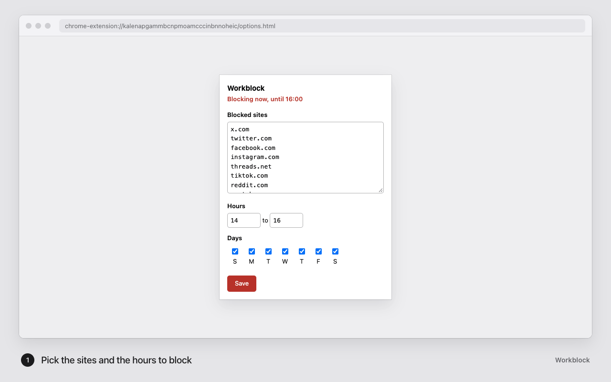

# Workblock

A Brave, Chrome and Safari extension that blocks distracting sites during your working hours, on a computer, an iPhone or an iPad.

**Status:** In use. It is not on the Chrome Web Store or the App Store, so you load it from a clone. Public repository with one owner.

<picture>
	<source media="(prefers-color-scheme: dark)" srcset="docs/demo-dark.gif" />
	
</picture>

Outside those hours it stays out of the way. There is no sudo, no daemon, no account, and no server. It reads the computer's clock and turns a set of `declarativeNetRequest` rules on and off.

## Quick start

You need Brave or Chrome on a computer.

```sh
git clone https://github.com/arianjinx/workblock.git
```

Then load the folder:

1. Open `brave://extensions` or `chrome://extensions`.
2. Turn on **Developer mode**, click **Load unpacked**, and pick the `workblock` folder.
3. Click the Workblock icon in the toolbar.

The popup shows your sites, hours, and days. Its status line reads `Off the clock. Nothing blocked.` outside the hours, or `Blocking now, until 17:00` during them.

### Safari on a Mac, iPhone, or iPad

Safari loads an extension only from inside an app, so you build a small wrapper app once, on a Mac with Xcode 14.3 or later:

```sh
xcrun safari-web-extension-converter /path/to/workblock \
	--project-location ~/workblock-safari --app-name Workblock \
	--bundle-identifier com.yourname.workblock --swift --no-open
```

The project it writes builds a macOS app and an iOS app. It points at the files in your clone, so a `git pull` and a rebuild update it.

On the Mac:

1. Open `~/workblock-safari/Workblock/Workblock.xcodeproj`, pick the `Workblock (macOS)` scheme, and click **Run**.
2. Without a signing team, turn on **Develop** > **Allow Unsigned Extensions** in Safari. The Develop menu appears once you tick **Show features for web developers** in **Settings** > **Advanced**.
3. In Safari's **Settings** > **Extensions**, tick **Workblock**.

On an iPhone or iPad:

1. Pick the `Workblock (iOS)` scheme and your device, set a signing team under **Signing & Capabilities**, and click **Run**. A free Apple ID works, but its builds stop opening after 7 days.
2. Open **Settings** > **Apps** > **Safari** > **Extensions** (**Settings** > **Safari** > **Extensions** on iOS 17 and earlier), and turn on **Workblock**.

Then open the Workblock popup from Safari's toolbar or the address bar's extensions menu and click **Save**. Safari asks to let Workblock read your blocked sites. Allow it, or open tabs on those sites stay put and only new visits are blocked.

## Requirements

- Brave or Chrome on a computer, Safari 16.4 or later on a Mac, or Safari on iOS and iPadOS 16.4 or later.
- For Safari, a Mac with Xcode 14.3 or later, once, to build the wrapper app.
- Nothing else to install. The extension has no dependencies and no build step.

## Usage

Click the toolbar icon, change the settings in [Configuration](#configuration), and click **Save**. The block starts or stops at once if the new hours say so.

During a block, an open tab on a blocked site and a new visit both land on the blocked page. The page names the site and the time the block ends. The tab keeps its link as `blocked.html?url=<the original URL>`. The visible tab goes back when the block ends. A background tab goes back when you switch to it.

To update, run `git pull` in the folder and click reload on the extension's card. Your settings stay.

### Why each permission

| Permission | Why Workblock needs it |
| --- | --- |
| `declarativeNetRequest` | Install and remove the block rules. |
| `alarms` | Wake the service worker once a minute to check the clock. |
| `storage` | Keep your sites, hours, and days in `chrome.storage.sync`. |
| `tabs` | Find tabs on a blocked site and move them to the blocked page. |
| `browsingData` | Remove service workers that would serve a blocked site from cache. Safari has no such API, so Workblock skips it there. |

The manifest also lists every site under `optional_host_permissions`. Chrome and Brave never ask for it. Safari hides a tab's address without it, so on Safari, **Save** asks for access to your blocked sites and nothing else.

## How it works

The popup saves settings to `chrome.storage.sync`. The service worker reads them every minute and on every change, then turns the block rules on or off and moves open tabs to the blocked page.

## Known limits

- Untick today, or disable the extension, and the block stops. This stops idle drift.
- One window, in whole hours. A window that wraps past midnight blocks nothing.
- The alarm can lag a block by up to a minute.
- This browser profile only.
- During a block, service workers and cache storage for blocked sites are cleared. Cookies stay.
- On Safari, service workers and cache storage are not cleared, the settings stay on one device, and the badge keeps Safari's own color.
- On Safari, an open tab moves to the blocked page only on a site you let Workblock read. Without that access, a new visit shows Safari's own error page instead.

## Configuration

Every setting has a default, so Workblock works from the first run.

| Setting | Default | What it does |
| --- | --- | --- |
| Blocked sites | the 10 sites below | One domain per line. `x.com` also blocks every subdomain. A pasted URL keeps only the domain. Lines that start with `#` are skipped. |
| Hours | 9 to 17 | Whole hours in local time. The start hour is inclusive and the end hour is exclusive, so 9 to 17 blocks from 09:00 through 16:59. |
| Days | Monday to Friday | The same window on each ticked day. |

The defaults are 09:00 to 17:00, Monday to Friday: `x.com`, `twitter.com`, `facebook.com`, `instagram.com`, `threads.net`, `tiktok.com`, `reddit.com`, `youtube.com`, `linkedin.com`, and `news.ycombinator.com`. The badge reads `ON` while a block is active.

## Development

There is no build. The folder is the extension, so reload its card after an edit.

You need Node 22 or later. The browser test also needs Chrome for Testing, because branded Chrome 137 and later ignores `--load-extension`. On Linux, `bash .agents/setup` installs what is missing: Node, Chrome for Testing, `xvfb`, `ffmpeg`, and ImageMagick.

Run the gate before every push. It installs from the lockfile offline, checks the repository's rules, parses every script, and runs `npm test`:

```sh
scripts/verify.sh
```

Measure the project against [GOAL.md](GOAL.md). The second command adds the browser test, which takes about 15 seconds:

```sh
scripts/score
SCORE_E2E=1 scripts/score
```

Run the browser test or record the demo on their own:

```sh
npm run e2e -- "/path/to/Google Chrome for Testing"
npm run demo
```

The Safari rung reads `scripts/safari-compat.json`, a slice of MDN's browser compatibility data. To refresh it, download `data.json` from the `@mdn/browser-compat-data` package and run `node scripts/safari-compat.mjs /path/to/data.json`. Nothing tests Workblock inside Safari itself, so try a Safari change on a Mac and a phone by hand.

With no path, `npm run e2e` starts Brave from its macOS install path. `npm run demo` rewrites the GIFs and screenshots in `docs/`, and needs `ffmpeg` and ImageMagick 7.

| Variable | Default | What it does |
| --- | --- | --- |
| `SCORE_E2E` | unset | Set to `1` to make `scripts/score` run the browser test. |
| `SCORE_CHROME` | the newest Chrome for Testing it finds | The browser `scripts/score` uses for the browser test. |
| `WORKBLOCK_CDP_PORT` | `9333` | The debugging port for `npm run e2e` and `npm run demo`. `scripts/score` picks a free one. |
| `GH_TOKEN` | the token from `gh auth token` | Used by `npm run prune` and `npm run ship`. Never print it. |

`npm run ship` pushes a branch, merges its pull request into `main`, then deletes merged worktrees and branches. `npm run prune` does only the deleting.

## Project structure

The repository is flat.

| Path | What it holds |
| --- | --- |
| `manifest.json` | The extension's manifest. |
| `schedule.js` | The defaults, the hour check, the rules, and the site parser. It uses no browser APIs. |
| `background.js` | The service worker: rules, tabs, badge, and cache clean-up. |
| `options.html`, `options.js` | The popup and the options page. |
| `blocked.html`, `blocked.js` | The blocked page and the return to the original link. |
| `e2e.mjs`, `cdp.mjs` | The browser test, driven over the Chrome DevTools Protocol. |
| `demo.mjs` | Records `docs/demo-light.gif`, `docs/demo-dark.gif`, and `docs/screenshots/`. |
| `scripts/` | The gate (`verify.sh`, `rules.mjs`), the meter (`score`, `score.mjs`), and the Safari support table (`safari-compat.json`, written by `safari-compat.mjs`). |
| `prune.mjs`, `ship.mjs` | The merge and clean-up helpers. |

## Contributing

Report bugs and ask questions in [GitHub issues](https://github.com/arianjinx/workblock/issues). Coding agents work in it by the rules in [AGENTS.md](AGENTS.md). Several agents work in it at the same time, so know these rules first:

- work in your own worktree, and push to `main`.
- end each change with `git pull --rebase && scripts/verify.sh && git push`. `scripts/verify.sh` is the gate.
- write commit messages as `type(scope): summary`, then why, with the commands and the numbers.
- only the owner changes a promise in this README or an expected value in `scripts/`.

This README is the spec. When the code and a sentence here disagree, the sentence wins, unless the owner changes the sentence or adds an entry to [docs/DEVIATIONS.md](docs/DEVIATIONS.md).

Before you change code, read [AGENTS.md](AGENTS.md) and [LOOP.md](LOOP.md). They set the rules for commits, file ownership, and tests. [FRONTIER.md](FRONTIER.md) records every score so far.

## License

[MIT](LICENSE), copyright 2026 Arian Pradana.
