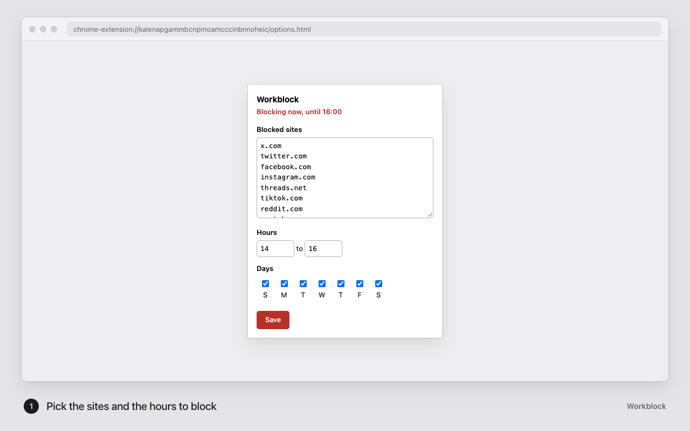

# Workblock

[](https://github.com/arianjinx/workblock/actions/workflows/ci.yml)
[](manifest.json)
[](package.json)
[](LICENSE)

A Brave and Chrome extension that blocks distracting sites during your working
hours and stays out of the way outside them.

There is no sudo, no daemon, no account, and no server. Workblock reads your
computer's clock and turns a `declarativeNetRequest` rule set on and off.

<picture>
	<source media="(prefers-color-scheme: dark)" srcset="docs/demo-dark.gif" />
	
</picture>

The demo above is a real browser running this folder as an unpacked extension.
A script records it, and `npm run demo` records it again after a UI change.

1. You set the sites, hours, and days in the toolbar popup.
2. When the block starts, an open tab on a blocked site moves to the blocked
   page. The page names the site and the time the block ends.
3. A new visit to a blocked site lands on the same page.
4. When the block ends, the tab goes back to the page it was on.

## Install from source

Workblock is not on the Chrome Web Store. Load it from this folder:

1. Clone this repo:

   ```sh
   git clone https://github.com/arianjinx/workblock.git
   ```

2. Open `brave://extensions`, or `chrome://extensions` in Chrome.
3. Turn on **Developer mode** in the top-right corner.
4. Click **Load unpacked** and select the cloned folder.

To update, run `git pull` and click the reload button on the Workblock card in
`brave://extensions`. Your settings stay.

## Set your sites and hours

Click the Workblock toolbar icon, change the settings, and click **Save**.
Changes apply as soon as you save.

- **Blocked sites.** Enter one domain per line. `x.com` also blocks
  `www.x.com`, `mobile.x.com`, and every other subdomain. If you paste a full
  URL, Workblock keeps only the domain. Lines that start with `#` are skipped.
- **Hours.** Enter whole hours in your computer's local time. The start hour is
  inclusive and the end hour is exclusive, so `9` to `17` blocks from 09:00
  through 16:59.
- **Days.** Tick the days the window applies to.

The defaults are 09:00 to 17:00, Monday to Friday, with these sites:
`x.com`, `twitter.com`, `facebook.com`, `instagram.com`, `threads.net`,
`tiktok.com`, `reddit.com`, `youtube.com`, `linkedin.com`, and
`news.ycombinator.com`.

The toolbar badge reads `ON` while a block is active.

## What a blocked tab does

During a block, any tab on a blocked site moves to Workblock's blocked page.
That includes tabs that were already open when the window started and new
visits during the window. The page shows the link the tab was on and the time
the block ends.

The tab keeps its link. Its URL becomes `blocked.html?url=<the original URL>`,
so the link survives tab groups, saved groups, and session restore, which keep
only a tab's current URL.

When the site is no longer blocked, the tab goes back to the original link by
itself. Only the tab you are looking at goes back right away, so a dozen
background tabs don't all reload at 17:00. Each one goes back when you switch
to it.

## How it works

`background.js` is the extension's service worker. It recomputes everything
from scratch on a one-minute `chrome.alarms` tick, on browser startup, and on
every settings change. Each run asks `schedule.js` whether the current local
time is inside your window, then either installs one dynamic block rule per
site or clears all of them.

The rules match with `requestDomains`, which covers subdomains. They block only
`main_frame` requests, which are top-level page loads. A YouTube video
embedded in another site still plays, and other sites can still call APIs on
blocked domains.

Network rules alone are not enough. Sites that ship their own service worker,
such as YouTube and a logged-in x.com, answer navigations from their cache, and
that request never reaches the layer where `declarativeNetRequest` runs. So on
every tick during a block, Workblock does two more things in this order:

1. It moves every tab on a blocked site to the blocked page.
2. It removes service workers and cache storage for `https://<site>` and
   `https://www.<site>`.

The order matters. A tab still showing the site registers its service worker
again as soon as Workblock removes it. With the worker gone, the next
navigation goes back to the network, where the rules apply.

A `tabs.onUpdated` listener catches new visits between ticks. Without it, a
new visit lands on the browser's own `ERR_BLOCKED_BY_CLIENT` error page.

### Why each permission

| Permission | Why Workblock needs it |
| --- | --- |
| `declarativeNetRequest` | Install and remove the block rules. |
| `alarms` | Wake the service worker once a minute to check the clock. |
| `storage` | Keep your sites, hours, and days in `chrome.storage.sync`. |
| `tabs` | Find tabs on a blocked site and move them to the blocked page. |
| `browsingData` | Remove service workers that would serve a blocked site from cache. |

## Limits

- **You can turn it off at any time.** Untick today in the popup, or disable
  the extension at `brave://extensions`. Workblock stops idle drift. It does
  not stop someone who has decided to get around it.
- **One window, in whole hours.** Every selected day gets the same window. You
  can't set a lunch break, a split shift, a 09:30 start, or a window that wraps
  past midnight. `test.mjs` asserts that a wrapping window blocks nothing, so
  the limit is explicit rather than silently wrong.
- **Up to a minute late.** A block starts and ends on the first alarm tick
  after the hour, so the switch can lag by up to about a minute.
- **This browser profile only.** Safari, your phone, and other browsers are
  not affected. For coverage across devices, block at the DNS level.
- **The cache purge deletes data.** During a block, Workblock clears service
  workers and cache storage for blocked sites every minute. Anything a blocked
  site keeps there for offline use is gone. Cookies are not touched, so you
  stay signed in.

## Why not an /etc/hosts blocker

The first version of Workblock edited `/etc/hosts` from a root LaunchDaemon. It did not work in the browser. Chrome's Secure DNS
setting defaults to `automatic`, which resolves names over HTTPS and skips
`/etc/hosts`. The block was written correctly, and the browser ignored it.

## Develop

There is no build step and there are no dependencies. The extension is plain ES
modules loaded straight from this folder. After you edit a file, click reload
on the Workblock card in `brave://extensions`.

| File | Contents |
| --- | --- |
| `schedule.js` | All the logic that can be wrong: the time window, rule building, host matching, site parsing, and the blocked-page URL. It imports no browser APIs. |
| `background.js` | The service worker that applies the schedule. |
| `blocked.html`, `blocked.js` | The blocked page and its logic for returning to the original link. |
| `options.html`, `options.js` | The settings page, used as both the toolbar popup and the options page. |
| `test.mjs` | Unit checks for `schedule.js`. |
| `e2e.mjs` | End-to-end checks in a real browser. |
| `demo.mjs` | Records `docs/demo-light.gif` and `docs/demo-dark.gif` in a real browser. |
| `cdp.mjs` | Starts a browser with the extension loaded and talks to it over the Chrome DevTools Protocol. `e2e.mjs` and `demo.mjs` both use it. |
| `.github/workflows/ci.yml` | The CI workflow. |
| `ship.mjs`, `prune.mjs` | The `npm run ship` and `npm run prune` commands. `prune.test.mjs` checks which worktrees and branches `prune` removes. |

Run the checks:

```sh
npm test                              # unit checks, plain Node
npm run e2e                           # Brave at its default macOS path
npm run e2e -- "/path/to/Chromium"    # Chrome for Testing or another Chromium build
npm run demo                          # record the README demo again
```

`npm run e2e` needs Node 22 or later. It opens a browser window with a
throwaway profile and remote debugging on port 9333, then blocks and unblocks
`example.com`. It checks that blocked tabs keep their link, that a background
tab waits until you view it, and that new visits land on the blocked page.

After you change `options.html` or the blocked page, run `npm run demo` and
commit the new GIFs and screenshots. The script needs `ffmpeg`, ImageMagick,
and network access, because the demo loads the Hacker News guidelines page.
`docs/screenshots/` holds the light frames at 1280x800, the size the Chrome
Web Store asks for.

CI runs `npm test` and `npm run e2e` on every push to `main` and every pull
request. The e2e job uses the current stable Chrome for Testing, because
branded Chrome 137 and later ignores `--load-extension`. CI also runs every
week with no code change, so the badge turns red when a new Chrome release
breaks the extension.

To merge a branch into `main`, commit your work and run `npm run ship` from the
branch. It merges `origin/main` into the branch, runs `npm test`, pushes, opens
a PR or reuses the open one, and merges it with a merge commit. Then it
fast-forwards your local `main` and runs `npm run prune`. To give the PR a
hand-written title and description, open it yourself first, and `ship` merges
that PR. Both commands call the GitHub API through `gh`, signed in as the repo
owner.

`npm run prune` removes every worktree, local branch, and remote branch whose
tip is the head of a merged PR. It keeps the current worktree, the main
checkout's branch, detached worktrees, worktrees that a running process uses as
its working directory, and any branch with commits after its merge. You can run
it again at any time.

## License

MIT. See [LICENSE](LICENSE).
